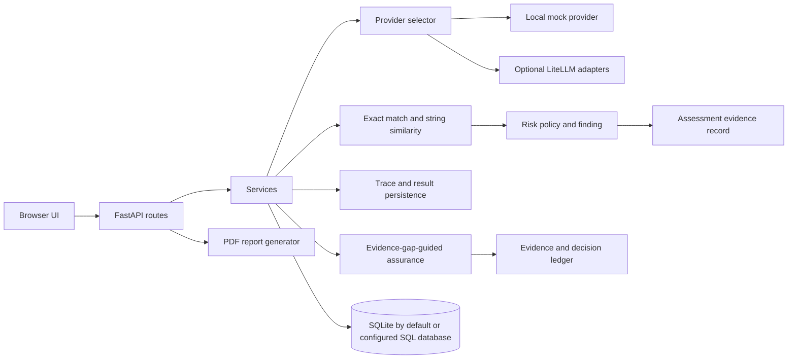

# AAOS architecture

AAOS is a synchronous FastAPI application backed by SQLAlchemy. The API routes call service functions, which access ORM models and the database session. Evaluation execution chooses a provider, saves each trace and evaluation result, calculates a risk score and finding, and writes certificate evidence.

## Important modules

- `backend/main.py`: application creation, route registration, `/health`, and UI/static-file serving.
- `backend/app/api/`: HTTP endpoints for agents, test runs, evaluation cases/results, attacks, providers, traces, analytics, certificates, and reports.
- `backend/app/services/evaluation_execution_service.py`: evaluation orchestration.
- `backend/app/services/llm_router/`: provider availability and selection.
- `backend/app/adapters/`: bounded LiteLLM client, vendor adapters, and deterministic local mock.
- `backend/app/engines/assurance/`: risk taxonomy, evidence freshness/confidence weighting, utility-based test selection, stop outcomes, and synthetic benchmark.
- `backend/app/services/assurance_service.py`: adaptive assurance orchestration and persistence.
- `backend/app/api/dataset_api.py`: dataset membership and run-time version/hash/case-ID/content snapshots.
- `backend/alembic/`: versioned, additive schema migration for assurance/dataset changes.
- `backend/app/engines/evaluation_engine/`: metric registry and evaluation logic.
- `backend/app/engines/risk_engine/`: policy thresholds and score adjustment.
- `backend/app/engines/flight_recorder/`: trace structure and persistence.
- `backend/app/engines/certification_engine/`: evidence JSON and certificate support.
- `backend/app/reports/`: PDF generation.
- `frontend/`: same-origin HTML/CSS/JavaScript demo.

## Local evaluation flow

The UI calls the existing agent, version, run, and case APIs. It associates each new evaluation case with its test run, then posts to `/evaluation-execution/{run_id}`. The service evaluates cases scoped to that run; if none exist, it falls back to unscoped cases created by older clients. In local mode, the mock provider always returns `Mock response.`. The evaluator stores exact-match and `SequenceMatcher` character similarity scores and a lexical word-overlap heuristic. The service then creates trace/result/risk/finding/certificate rows. Report generation reads those records and returns a PDF.

New dataset-bound runs preserve the selected case IDs and content, along with the dataset version and content hash; later dataset edits do not change the inputs of those runs. Historical runs created before content snapshots continue to load cases by ID. Evaluation runs are single-use to avoid duplicate results and assessments. EGAA persists evidence records, selection decisions, and tool executions. Its generic Python callback budget cannot interrupt a blocking callback; subprocess adapters enforce their own process timeout.

API protection uses a configured Bearer token when `API_TOKEN` is set; otherwise protected APIs are restricted to loopback clients. Health, static UI, and docs remain accessible. This is a local-development safeguard, not production authentication or authorization.

This is a prototype workflow, not a calibrated or independently validated assurance process. No real provider or external assurance framework was executed for verification. Provider status represents configuration only, not a live health check. EGAA benchmark results are synthetic fixtures.
